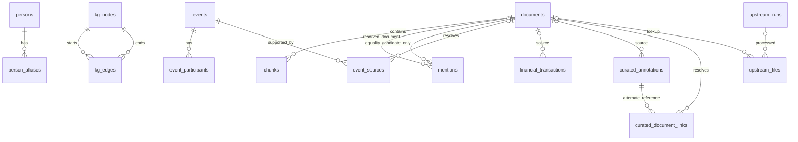

# Full Z1 relational model

Status: implemented model. Full-load results and repeat proof are recorded in import-report.md and evidence/. The model
uses the complete prescribed source and independent Z1 code. No checkpoint code
or outputs are used. Read together with [import-design.md](import-design.md) and
the [data-mapping.md](data-mapping.md).

## Evidence behind the decisions

The source contains 15,725,373 rows across 56 Parquet shards in 13 layers.
[data-profile.md](data-profile.md) contains the original full profile.
[schema-analysis.json](../evidence/schema-analysis.json) contains additional
aggregate checks made by [analyze_z1.py](../scripts/analyze_z1.py). Reproduce from
the project root:

```powershell
.\.venv\Scripts\python.exe scripts/analyze_z1.py
```

These checks export metadata and aggregates, not document text or person names.
The manifest is verified before any analysis. Counts describe source records;
they are not automatically counts of distinct real-world documents or people.

| Measured fact | Consequence for the model |
|---|---|
| All source `id` columns are nonnull and unique within their layer | Preserve these IDs as table-specific `source_id BIGINT` primary keys; no renumbering needed |
| Document `file_key` is nonnull and globally unique in this revision | Add `UNIQUE(file_key)` and use exact file-key matches as document lookup candidates |
| Every chunk references an existing document; `(document_id,chunk_index)` is unique | Real document FK plus a composite unique constraint; preserve the source chunk ID |
| 14,863 chunk ends exceed the parent's reported `char_count`, but only 81 exceed the actual text length | Keep both reported length and original offsets; store an offset diagnostic and issue. Do not silently repair offsets or discard chunk text |
| All 10,629,198 entity `normalized_value` values are NULL | Preserve the upstream field; compute a separate versioned search normalization |
| 78 entity document IDs have no numeric document match | Retain raw document ID and unmatched state; numeric matches for the other rows still do not prove namespace identity |
| 1,614 person rows have only 1,608 distinct slugs | Source ID is the key; slug is searchable text, not UNIQUE |
| All person aliases/search terms/sources are JSON arrays; aliases contain 241 string elements | Preserve raw JSON and parsed JSONB; derive a person-alias table with array position |
| KG metadata is JSON objects; all 2,198 edge endpoints exist | Relational node/edge tables with two real FKs and JSONB metadata |
| All participant/source event IDs resolve | Required event FKs; participant names remain names, without an inferred person ID |
| 16,651 of 21,910 event-source file references do not match a document | Optional resolved document FK, original file key and explicit unmatched state |
| All 49,770 financial file keys resolve; 482 source dataset labels disagree with the matched document | Preserve both dataset labels through the linked document and raw transaction field; flag disagreement rather than overwrite |
| Financial amounts: 551 missing, 18,237 negative, 532 zero, 30,450 positive | Missing is NULL; negatives and zero are valid values, not errors |
| All financial rows use USD; 38 amounts differ from their two-decimal rounding | Group by currency anyway; do not impose a two-decimal scale or invent original decimal precision |
| Curated annotations have 104 extra occurrences of file keys, with distinct annotation IDs | Keep every annotation; file key must not be the annotation's unique key |
| Provenance file keys have eight extra occurrences; `(output_name,file_key)` is unique | Use that composite primary key; repeated file keys across outputs are not duplicate records |
| 63,676 provenance file rows have no run ID; supplied run IDs all resolve | Optional upstream run FK and missing state |
| Five provenance file records have no matching document file key | Add nullable document lookup with raw key/state; retain the processing records |
| Email metadata: 631 objects, four arrays, 1,424,038 SQL NULL values | Preserve valid arrays and record unexpected shape; do not force all JSON into objects |
| Of 631 email objects, 20 have a present `subject` key whose value is JSON null | Demonstrate key absence versus JSON null in queries and synthetic tests |
| Document dates contain 1,209 year-only and ten month-only strings, and much free-form text | Preserve precision and raw text; failure of generic timestamp casting is not automatically an invalid date |
| All document `created_at` timestamps lack an explicit zone; upstream timestamps mix zoned and unzoned syntax | Separate local timestamp from known instant; never assume UTC for an unzoned value |

The 81 offset failures compare DuckDB character counts, not bytes. They are
diagnostics pending confirmation of the upstream offset convention. The 38
amounts are a binary-floating-point comparison against two-decimal rounding;
this does not reconstruct decimal amounts printed on the original statements.
Date syntax and zone suffixes identify shapes, not calendar validity.

## Table boundaries and keys

Use a `z1` schema for domain tables and `z1_audit` for our source catalog and
import bookkeeping. Each working database represents one frozen source revision.
The importer must refuse to mix a different revision or transformation version
into existing tables.

| Source layer | Target table | Primary key | Why keep this boundary? |
|---|---|---|---|
| documents | `z1.documents` | `source_id BIGINT` | One source document with its text and metadata; parent of chunks and supported document references |
| chunks | `z1.chunks` | `source_id BIGINT`; UNIQUE `(document_id,chunk_index)` | Multiple ordered text units per document; supports FTS and source-offset traceability |
| entities | `z1.mentions` | `source_id BIGINT` | Extraction occurrences, not a registry of confirmed identities |
| persons | `z1.persons` | `source_id BIGINT` | Curated registry remains distinct from mentions and KG nodes |
| kg_entities | `z1.kg_nodes` | `source_id BIGINT` | Own graph namespace; a person-like graph node is not automatically a persons-table identity |
| kg_relationships | `z1.kg_edges` | `source_id BIGINT` | Edge identity and direction must survive Q3, including multiple edges between the same nodes |
| derived_events | `z1.events` | `source_id BIGINT` | One reconstructed event with dates, type, narrative and optional monetary information |
| event_participants | `z1.event_participants` | `source_id BIGINT` | Multiple participant observations/roles per event; a name is not a person FK |
| event_sources | `z1.event_sources` | `source_id BIGINT` | Evidence links are independent records; repeated file keys across events are expected |
| financial_transactions | `z1.financial_transactions` | `source_id BIGINT` | One extracted transaction per source ID; keep extraction and document provenance |
| curated_docs | `z1.curated_annotations` | `source_id BIGINT` | Different annotations may concern the same document; preserve their subjects and detail |
| provenance/runs | `z1.upstream_runs` | `run_id TEXT` | Source processing runs, independent of our imports |
| provenance/files | `z1.upstream_files` | `(output_name TEXT,file_key TEXT)` | Identifies a source processing output for a file, not necessarily a processing attempt history |

`source_id=42` in documents and `source_id=42` in persons are different identities.
The effective namespace is repository + revision + layer + original ID. Table
boundaries and the recorded frozen source snapshot carry that context.

Add two derived relational tables:

| Table | Key and relationship | Reason |
|---|---|---|
| `z1.person_aliases` | PK `(person_id,alias_position)`; FK person_id -> persons.source_id | Search aliases as individual rows; array position preserves repeats instead of silently collapsing them |
| `z1.curated_document_links` | PK `(annotation_id,link_position)`; FK annotation_id -> curated_annotations.source_id; optional document FK | Preserve alternate file keys from `also_appears_as` as explicit references with raw key and resolution state |

Search terms and source citations stay raw + JSONB on persons initially. We do
not assert that a source citation string is a document identifier. Further
splitting is justified only if a query needs it and its meaning is established.

## Relationships and deletion policy



The diagram omits audit FKs for readability. Required parent FKs: chunks ->
documents; both KG edge ends -> nodes; participants -> events; event sources ->
events; alias -> person; alternate link -> annotation. Missing required parents
quarantine a row. A nullable document lookup is allowed for event sources,
financial records, annotations, alternate links and provenance file records.
Missing or unresolved optional links must preserve their raw value and state.

For mentions, keep `raw_document_id`, optional `candidate_document_id`, optional
`document_id`, and `document_match_status`. Candidate IDs have an FK to document
existence but are labelled equality candidates, not accepted resolutions. Until
source namespace evidence is sufficient, matching values have status
`namespace_unverified` and `document_id` stays NULL. Unmatched values have no
candidate. This is a conservative core policy, not a claimed advanced resolver.

All nonnull link columns have real FOREIGN KEY constraints. A resolved state
requires a nonnull resolved ID; missing/unmatched/unverified states cannot claim
a resolved ID. Use CHECK constraints to enforce this correspondence.

Domain and lineage links use `ON UPDATE RESTRICT ON DELETE RESTRICT`; audit bookkeeping
links use PostgreSQL default NO ACTION. Both reject removing referenced parents. Frozen
source identifiers are immutable. Removing a document must not erase its evidence
or processing history through cascading deletion. A deliberate rebuild targets
only the separately identified working schema, rather than deleting individual
parents behind dependent rows. Nullable FKs indicate optional resolution, not
permission for a nonexistent nonnull target.

## Types and transformations

### IDs, text, counters and flags

Use BIGINT for source BIGINT IDs and metrics, INTEGER for source INTEGER fields,
BOOLEAN for source flags, and TEXT for source strings. Preserve source NULL and
blank values separately. Do not invent NOT NULL/defaults for unknown handwriting
or stamps, truncate long text, or make names/slugs unique. Account digits and
document/page numbers remain text to preserve formatting and leading zeros.
All original fields are retained, including fields currently entirely NULL.

All domain source rows also carry `input_file_id`, `source_row`,
`loaded_by_run`, and a deterministic raw-record fingerprint. File and run columns
have FKs to audit tables. The row ordinal is physical Parquet row number + 1,
not a number allocated by insertion order. Derived alias/link rows trace through
their parent plus original array position. The mapping document lists every
source field and distinguishes raw values from derived fields. Source payload fingerprints use
sorted field names, typed tags, 8-byte lengths, UTF-8 text and IEEE float bytes; PostgreSQL
independently reconstructs them from every accepted row during validation.

### Dates and timestamp zones

For a date-like field `d`, retain `d_raw TEXT` plus `d_state` and `d_precision`.
Use `d_year SMALLINT`, `d_month SMALLINT`, `d_day DATE`,
`d_local_timestamp TIMESTAMP WITHOUT TIME ZONE`, and `d_instant TIMESTAMPTZ` as
appropriate; only the representation corresponding to precision is populated.
An exact day stores its year/month too. CHECK constraints enforce consistency.

States: missing (SQL NULL), empty, parsed, invalid (recognized format with invalid
calendar value), and unparsed (unsupported/free-form meaning, including unknown
precision). Partial year/month precision is explicitly recorded on parsed values. Precision: year, month, day, local timestamp,
or zoned timestamp, NULL when unknown. `2015` yields year precision, not an invented
January 1; `2015-02` yields month precision; `2015-02-30` is invalid. A free-form
phrase remains raw and unparsed unless a documented parser supports it. All
problem states are logged, with severity reflecting uncertainty versus an error.

For timestamp-only metadata use raw text, state, local timestamp and instant;
record precision when finer/coarser precision matters. An explicit numeric offset
or Z permits an instant; absent zone permits only a local timestamp. Retain raw
text because a normalized TIMESTAMPTZ does not preserve the original offset text.
Do not use document acquisition/creation time as the document's historical date.

### JSON

Keep `email_fields_raw TEXT`, parsed `email_fields JSONB`, and parse state.
Other JSON-encoded fields use the same pattern: person arrays, KG metadata and
curated alternate file keys. SQL NULL means no source value; JSON null is stored
as actual JSONB null; absent object keys remain absent. Invalid JSON has raw text,
SQL NULL parsed representation, invalid state and an issue. Valid arrays remain
arrays; unexpected shape is an issue rather than an invented object.

Object key order/spacing are preserved in raw text, because JSONB normalizes its
representation. Reject nonstandard NaN/Infinity JSON tokens; detect duplicate
object keys and record their normalization issue. Parsing must also handle JSON
that PostgreSQL JSONB cannot represent (such as forbidden Unicode escapes) and
retain the raw source with an issue. Required array-derived rows are emitted only
from valid arrays with valid string elements; invalid elements are recorded, not
silently removed. [PostgreSQL JSON documentation](https://www.postgresql.org/docs/18/datatype-json.html).

### Money and numeric confidence

Source amounts are DOUBLE, so their original decimal precision is already lost.
Keep `amount_raw DOUBLE PRECISION`, derived `amount NUMERIC` without forced scale,
and `amount_state`. For finite values, Python `Decimal.from_float()` represents
the actual source binary float exactly. This can produce many decimal places;
it does not reconstruct the amount originally printed on a statement. No
rounding to cents occurs in storage. Presentation rounding is explicitly separate.

Missing amount -> NULL/missing; nonfinite amount -> NULL/invalid with a logged
issue; zero and negative values remain valid. Keep raw currency and a separate
trimmed-uppercase currency grouping value; absent/blank/unrecognized currency
stays explicitly unknown. Do not sum across currencies or assume USD for future
unknown rows. The same policy applies to event amount and upstream cost_usd;
cost_usd has an explicitly USD meaning. [PostgreSQL numeric documentation](https://www.postgresql.org/docs/18/datatype-numeric.html).

Graph weight stays DOUBLE PRECISION as a source graph metric, not money or
probability. The event confidence field is TEXT and stays TEXT. Financial
extraction confidence is not our matching confidence: retain its raw float and
validate any parsed confidence separately before imposing a 0..1 constraint.
No numeric matching confidence is fabricated.

### Names and identity

Keep mention `value_raw` and upstream `normalized_value_raw`. Derive
`search_value` with version `nfkc-casefold-space-v1`: Unicode NFKC, casefold,
collapse whitespace and trim. Do not remove accents or infer person identity.
Apply the same search normalization to names/aliases where useful. Participant
names, payer/payee and merchant names remain observations. No person FK is
assigned solely because two strings match. A fuzzy score is a search score.

## Workload and index direction

| Requirement | Supported by this design |
|---|---|
| Q1 full-text | Chunks retain content and source ID; derive a `tsvector` with an explicitly fixed configuration and GIN index |
| Q2 fuzzy search | Person/alias or mention search values with source IDs and a trigram index; output method/threshold/score |
| Q3 exactly two edges | Two joins on relational directed KG edges; output both edge IDs and all three nodes, with explicit repetition policy |
| Q4 financial aggregation | NUMERIC amount, amount state, raw/normalized currency, transaction date precision and merchant fields |
| Q5 upstream provenance | Composite file-output identity and upstream run FK; count file-output records or distinct file keys explicitly |
| Q6 own question + JSONB | For example, email-metadata completeness by dataset, distinguishing missing JSON, arrays, absent keys and JSON null |
| R2 implemented extension | Materialized financial report by currency/merchant; full Q4 equivalence, refresh/repeat/rollback and separate synthetic staleness demonstration |

Keep PK/UNIQUE/FK constraints active. The implemented section 7 workload uses
FTS GIN, canonical-person trigram GIN, a composite financial B-tree and a partial
JSONB GIN. See [queries-and-indexes.md](queries-and-indexes.md) for SQL, operators,
key order/opclasses, actual sizes/build costs and full-result verification.
The full-input before/after benchmark uses the Q6 JSON drill-down and its partial
JSONB GIN; see [benchmark.md](benchmark.md). Section 7 verification remains a
separate correctness check.

## What remains to prove

The DDL and transformations are implemented. See import-report.md for measured
source accounting, constraint and original-field checks, and evidence/import-repeat.json
for full-content repetition proof. Entity namespaces remain unverified by policy; this
is preserved explicitly, rather than claimed as successful identity resolution.
Queries, auxiliary workload indexes and the section 8 benchmark are implemented.
R2 is implemented as the separate derived `z1.financial_report` materialized view;
see [extension.md](extension.md). Its DDL lives in `sql/extension.sql`, applied after
the full ETL. It does not change the source-field mapping or the original model.
The AI report is finalized with recorded review and metadata; defense and final
submission preparation remain.
